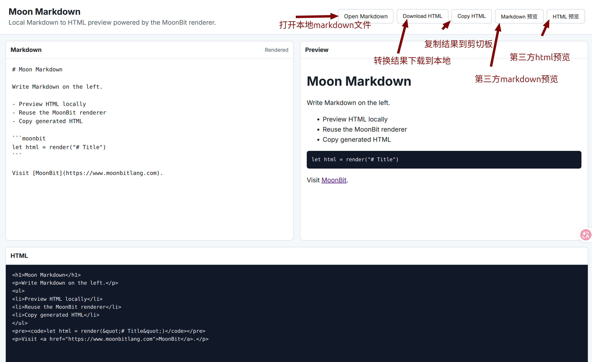

Moon Markdown 是一个用 MoonBit 编写的小型 Markdown to HTML 渲染器。项目把范围收在一个实用、可预测、易嵌入的语法子集，让 CLI 和浏览器入口复用同一个 render(markdown) 核心。



## 三个入口，一份渲染逻辑

- 作为库：传入 Markdown 文本，得到 HTML 字符串。
- 作为 CLI：把 Markdown 文件转换到标准输出或 HTML 文件。
- 作为浏览器 UI：编辑、实时预览、上传文件并复制或下载结果。

## 小范围支持也是一种设计选择

项目 README 列出的支持项包含标题、段落、链接、图片、引用、列表、代码块、表格和转义等常用语法，也明确写出 Setext 标题、删除线和脚注尚未支持。这个范围说明让使用者能预期输出，也让测试可以围绕实际行为展开。

```moonbit
let html = render("# Title\nHello [`MoonBit`](https://www.moonbitlang.com)")
```

## 从功能到验证

仓库包含 renderer 源码、测试、CLI、Web 页面和输入输出示例。图片语法、属性转义和残缺语法回退等边界可以通过这些示例逐项检查。

这种组织方式把“一个功能能用”拆得更具体：正常输入产生什么 HTML，属性里的特殊字符怎样处理，输入写到一半又应该怎样回退。

## 使用时从示例开始

```bash
moon run cli --target js example.md output.html
```

输入输出 fixture 能帮助检查不同入口是否仍然一致。新增语法时，在同一份示例里补一个最小输入与预期输出，比只看浏览器里的视觉效果更容易发现边界变化。

更多入口与语法说明见 [项目页](/projects/moon-markdown/) 和[公开仓库 README](https://github.com/submergepsc/moonbit)。本文描述这一小型渲染器的实现范围，未将其视为完整 CommonMark 实现。
